# Yaesu ACC spectrum

Can Yaesu Web Control (YWC) get a Yaesu's own scope data from the ACC socket,
through an ESP32-S3 over USB?

The work starts on an FTdx101MP. The FTDX101D and FTDX10 are expected to send the
same data on the same socket ([other people's projects](#credits-and-background) have done it on the FTDX10),
so the same board and code should suit them too. The FT-710 doesn't need it: it
already sends its scope over USB, and YWC uses that.

Status: **investigation. Stage 1 of the level checks passed on 2026-11-10: every
line is 3.3 to 3.4 V, and the radio streams when its heartbeat is answered.
Nothing built yet.** See [Oscilloscope traces](#oscilloscope-traces).
The full plan is in [docs/plan.md](docs/plan.md).

The extension cable isn't cut. A ready-made 13-pin plug with wires, from the
IC-7300MK2, goes into its female end, so the board is easy to plug in and unplug.

## Use at your own risk

**Everything in this repository is used entirely at your own risk.** Connecting
anything to the ACC socket can blow a fuse or damage the radio's main board, and the
repair may mean sending the radio back to Yaesu. If you damage your radio, or anything
else, that's your responsibility. The author accepts no liability for it, and nothing
here is approved or supported by Yaesu. There is no warranty of any kind, and the
information here may be wrong. Read [docs/fuse-risk.md](docs/fuse-risk.md) first.

## The board's LED

The board is an ESP32-S3 DevKitC-1 N16R8, marked HW678, and its RGB LED is on GPIO48
in GRB order, so it's free for status lights. It's an addressable LED, so it needs a
data stream, not a plain high or low. It's driven with the
[Adafruit NeoPixel](https://github.com/adafruit/Adafruit_NeoPixel) library and kept
dim, because it's dazzling at full power.

Some boards differ: version 1.1 of the DevKitC-1 has its LED on GPIO38, which this
project uses for pin 12. Check yours before wiring it. See "The cable and the board"
in [docs/plan.md](docs/plan.md).

## Wiring


**Pin numbers.** In this repository, "pin" always means a pin of the radio's ACC
socket, numbered as in the radio's manual. The breakout board's screw terminals are
marked with the ESP32's GPIO numbers, so they're called terminals, such as
terminal 38. This table converts one to the other:

| ACC pin | Signal | Wire | Breakout terminal |
|---|---|---|---|
| 2 | GND | Red | GND, no resistor |
| 3 | DATA1 | Orange | 14 |
| 4 | DATA2 | Yellow | 11 |
| 5 | CLOCK | Green | 10 |
| 6 | CS | Blue | 13 |
| 11 | CNT RX | Pink | 39 |
| 12 | CNT TX | Light blue | 38 |

The six signal wires that go to the ESP32 (ACC pins 3, 4, 5, 6, 11 and 12) each
have a 470 ohm resistor in series at the terminal end. Ground (ACC pin 2) goes
straight to GND.

These pins are **not connected** and have no resistors. Heat-shrink over the end of
each wire, one wire at a time, is all they need:

- Pin 1, brown: Power ON, the remote power-on line
- Pin 7, purple: 3.3 V through 1k, which can't power anything
- Pin 8, gray: 13.8 V behind a fuse
- Pin 9, white: the radio's PTT line
- Pin 10, black: the radio's SEND line
- Pin 13, light green: a second ground; pin 2 is the one I use

The details, and the checks to make before connecting anything, are in "Wiring to
the ESP32-S3" in [docs/plan.md](docs/plan.md).

### Resistor value and the 2 MHz clock

The resistors are there for protection while the radio's levels are still unknown.
The [FTDX10 projects](#credits-and-background) this follows wire straight through with no resistors, and it
works. A resistor at the ESP32 end also softens fast edges and damps ringing. That
may help with the crosstalk [SLTPLAN](https://github.com/SLTPLAN/FTDX10_WF_HUB) worked around by lowering the ESP32's drive
strength on the pin 11 line.

The fastest line is the 2 MHz SPI clock. Each half-cycle lasts 250 ns. With a short
wire into the ESP32 (about 30 pF in all), the resistor slows each edge by roughly
the rise time below. The protection columns show the most current that can flow in
two faults: a 3.3 V line shorted to ground or crossed with another line, and a line
that turns out to be 5 V, pushing current into the ESP32's protection diodes. Less
current is better.

| Resistor | Edge rise time (10 to 90%) | Share of a half-cycle | 3.3 V line shorted or crossed | Line at 5 V, into the ESP32 | Protection compared with 220 ohm |
|---|---|---|---|---|---|
| 220 ohm | about 15 ns | 6% | 15 mA | 7.7 mA | 1 x |
| 330 ohm | about 22 ns | 9% | 10 mA | 5.2 mA | 1.5 x |
| 470 ohm | about 30 ns | 12% | 7 mA | 3.6 mA | 2.1 x |
| 1k | about 65 ns | 26%, still works but getting soft | 3.3 mA | 1.7 mA | 4.5 x |

The table shows 470 ohm as the best balance: twice the protection of 220 ohm, at
12% of the clock's half-cycle, and that's why it was chosen.

The 5 V figures assume the ESP32's pin is clamped at about 3.3 V. Espressif doesn't
publish a safe current into a pin, so treat any 5 V line as a reason to stop and add
level shifting, not something the resistor makes safe. No resistor protects against
pin 8: 13.8 V through 470 ohm is still about 22 mA, which is why pin 8 isn't
connected at all.

Clock and data each have the same resistor, so they're delayed together and stay in
step. If the scope shows rounded clock edges at the ESP32 pin, use a lower value
on the clock line.

### Yes, ground is the red wire

Red for ground looks like the last thing any sane person would do, but the colours
aren't my choice. They come with the ready-made 13-pin lead (the IC-7300MK2's ACC
plug), and they follow the resistor colour code by pin number, not by what the wire
does: pin 1 brown, 2 red, 3 orange, 4 yellow, 5 green, 6 blue, 7 purple, 8 gray,
9 white and 10 black. Pink, light blue and light green cover pins 11 to 13. Pin 2 is
ground, so ground is red.

The upside is that anyone who knows the code can read a wire's pin number from its
colour. The downside is that the usual meanings don't apply:

- **Red is ground.** Mark it GND with a label or a band of tape.
- **Gray is 13.8 V** (pin 8). It's not connected.
- **Black is SEND** (pin 10), not ground. It's not connected.
- Blue and light blue are different signals, and so are green and light green.

Other leads may use other colours, so check yours with a meter before wiring.

## Safe first connection

The radio's levels on these pins are measured before anything is connected to them.
The ESP32 goes on only once every line is known to be 3.3 V or less. There are two
stages:

1. **Stage 1:** the breakout on the radio, nothing else connected, and the
   oscilloscope on each line.
2. **Stage 2:** the radio powered off, the ESP32 connected, then power on and check
   again.

Three rules apply all the way through:

- **Unplug the radio's DC lead before plugging or unplugging anything.** Switching
  the radio off on its front panel isn't enough.
- **Move probes and wires only with the DC lead out.** A probe that slips on a live
  terminal can short two lines.
- **The scope's ground clips go only on pin 2, the red wire.** A mains-powered
  scope's ground is mains earth, so a ground clip on any other line shorts that line
  to earth.

### Before you start

- Every unused wire (pins 1, 7, 8, 9, 10 and 13) has its own heat-shrink over the
  end.
- With the cable out of the radio, pin 8 meters open to every other pin and to the
  shell. See [docs/fuse-risk.md](docs/fuse-risk.md).
- The 470 ohm resistors can stay in place. With no ESP32 connected, no current flows
  through them, so the far end of each resistor sits at the same voltage as the
  radio's pin. A 10 Mohm scope probe draws less than a microamp, which drops less
  than a millivolt across 470 ohms. Measuring at the free end of the resistor is
  the same as measuring at the radio.
- Set up each scope channel:
  - Probe at 10X, and the channel set to 10X to match. Check this on the scope's
    calibration output, which should read 3 V peak to peak.
  - 1 V/div with the trace near the bottom of the screen, so the screen shows 0 to
    about 7 V and a 5 V line can't go off the top.
  - DC coupling.
  - Trigger on the channel you're watching: rising edge, about 1.5 V, DC
    coupling, Normal mode.

### Stage 1: radio only, no ESP32

1. With the DC lead out, plug the breakout into the ACC socket. Clip the probe
   ground to ACC pin 2 (the GND terminal), and put the probe tip on the free end
   of ACC pin 12's resistor (terminal 38).
2. Plug in the DC lead and switch the radio on. Wait for it to finish starting.
3. **ACC pin 12 (CNT TX, out of the radio), terminal 38:** expect a short burst once a second. This
   is the `alive` heartbeat: 6 bytes at 115200 baud, about 0.5 ms long, so try
   1 ms/div. Note the high level.
4. Switch off, pull the DC lead, and move the probe to the next line. Repeat for
   **ACC pin 11** (CNT RX, an input to the radio, terminal 39) and **ACC pins 3,
   4, 5 and 6** (the SPI lines, terminals 14, 11, 10 and 13). Without a reply to the heartbeat, the SPI lines should stay idle. Note
   each line's idle level. With a 4-channel scope, you can watch pins 12, 6, 5 and
   4 at once, all ground clips on pin 2.
5. **Link ACC pins 11 and 12 (terminals 39 and 38).** With the DC lead out, join the free ends of the pin 11
   and pin 12 resistors with a short wire. The radio's heartbeat now comes back to
   it through 940 ohms, which is the reply it wants. Power on and look again:
   - Pin 12 still bursts once a second, and pin 11 shows the same burst.
   - After two or three seconds, **pin 6 (CS)** goes low 25 times a second,
     **pin 5 (CLK)** shows a 2 MHz clock while CS is low, and **pin 4 (DATA2)**
     carries data. Note whether **pin 3** does anything, and whether that
     changes with the Sub receiver on.
   - Note the high level of every line.
6. **Take the link off** (DC lead out first), power on, and watch pins 5 and 6.
   The data should stop within two or three seconds, while pin 12 carries on once a
   second. That shows the heartbeat reply is what turns the data on.

**Pass:** every line's high level is 3.3 V or less. The ESP32-S3's absolute maximum
is 3.6 V. **If any line goes above 3.6 V, stop.** Don't connect the ESP32. That line
needs level shifting first, and the resistor doesn't make it safe. Write the levels
in [docs/bench-notes.md](docs/bench-notes.md) either way.

### Stage 2: adding the ESP32

1. **Make sure the ESP32's pins are all inputs.** Old firmware on the board may
   drive some of these GPIOs as outputs, so erase it first, as in
   [Erasing the ESP32](#erasing-the-esp32) below. After an erase, every GPIO is
   an input. None of the GPIOs used here (10, 11, 13, 14, 38 and 39) is a
   strapping pin, so the board starts normally with the radio connected.
2. Pull the radio's DC lead. Connect the ESP32's GND terminal to pin 2 **first**,
   then the six resistor ends to their GPIOs, as in [Wiring](#wiring).
3. Leave the pin 11 to pin 12 link on, so the radio streams while the ESP32
   only listens.
4. **Power the ESP32 first:** plug its USB lead into the PC. Then plug in the
   radio's DC lead and switch on. When finishing, switch the radio off first and
   the ESP32 last. That way, the radio never drives a line into an ESP32 that has
   no power. An unpowered ESP32 would be fed through its protection diodes.
5. Repeat the checks from stage 1, step 5, with the probes at the ESP32 terminals.
   The levels should be the same as before, and the edges a little softer. The
   data should still start after two or three seconds.
6. When firmware takes over the heartbeat reply on GPIO39, take the link off
   first, with the DC lead out. Otherwise the radio's pin 12 and the ESP32 would
   both drive the same line. The 940 ohms keep that below 4 mA, but it's still a
   fault.

### Erasing the ESP32

Erasing wipes everything in the ESP32's flash, so it runs no program at all and
every GPIO stays an input. Do it with the ESP32 off the breakout and nothing wired
to its terminals except what's always there.

**Find the ESP32's COM port first.** Plug the ESP32's **UART** socket into the PC
with a USB data lead. Open Device Manager and look under "Ports (COM & LPT)". The
board's port is the one that appears when you plug it in and goes when you unplug
it. On a board with a CH343 chip it's named "USB-SERIAL CH343". **Never pick the
radio's ports.** The Yaesu's ports are a pair named "Silicon Labs Dual CP2105" or
"Silicon Labs CP210x", Enhanced and Standard. If in doubt, unplug the radio's USB
lead while you do this.

Then use either of these.

**Option 1: in the browser, nothing to install.** This needs Chrome or Edge.

1. Open Espressif's [ESP Tool](https://espressif.github.io/esptool-js/) page.
2. Under Program, leave the baud rate as it is and click **Connect**.
3. Choose the ESP32's port from the list and click Connect. The page shows the
   chip, "ESP32-S3".
4. Click **Erase Flash** and wait for it to finish. It takes a few seconds.
5. Click **Disconnect**.

A good run looks like this (MAC address left out):

```
Serial port WebSerial VendorID 0x1a86 ProductID 0x55d3
Connecting...
Detecting chip type...
ESP32-S3
Chip is ESP32-S3 (QFN56) (revision v0.2)
Features: Wi-Fi,BLE,Embedded PSRAM 8MB (AP_3v3)
Crystal is 40MHz
Uploading stub...
Running stub...
Stub running...
Changing baudrate to 921600
Changed
Flash ID: 184068
Erasing flash (this may take a while)...
Chip erase completed successfully in 4.819s
```

The lines to check:

- **VendorID 0x1a86** is WCH, the maker of the board's CH343 USB chip, so it's the
  ESP32's port and not the radio's. The radio's Silicon Labs chip is 0x10c4.
- **ESP32-S3** and **Embedded PSRAM 8MB** confirm the N16R8 board.
- **Chip erase completed successfully** is the one that matters.

Your revision, MAC address and timing may differ.

**Option 2: esptool from the command line.** Install it once with
`pip install esptool`, then run this, with your board's port in place of COM5:

```
python -m esptool --chip esp32s3 --port COM5 erase-flash
```

Older versions of esptool, before 5.0, spell the command `erase_flash`.

**If it can't connect** ("Failed to connect" or "No serial data received"), put
the board into download mode by hand. Hold the **BOOT** button, press and release
**RST**, then release BOOT, and try again. Once it's erased, press RST to restart
the board.

After an erase, the board's LED stays off. If you open a serial monitor on the
UART port, the board repeats a line like `invalid header: 0xffffffff`. That's
normal for an erased board. It means there's no program to run, which is what you
want.

## Oscilloscope traces

Every trace from the bench goes here, so anyone checking the work can see what each
ACC line does on an FTdx101MP. They're taken on my Siglent SDS1104X-E with the
probe at 10X, 1 V/div, DC coupling, and the ground on ACC pin 2, and read off the
scope over its LAN port with [tools/scope_shot.py](tools/scope_shot.py). The
pictures are in [docs/images/scope/](docs/images/scope/), the samples behind them
in [captures/scope/](captures/scope/), and the measured numbers in the Levels table
in [docs/bench-notes.md](docs/bench-notes.md). In every picture the bottom
graticule line is 0 V and each division up is 1 V.

**Pin numbers are ACC socket pins.** The probe goes on the breakout board's
terminal for that pin, shown in brackets, at the free end of the pin's 470 ohm
resistor. See the table in [Wiring](#wiring).

**File names.** The script names each picture from the ACC pin on each channel,
a note of what it shows, the timebase and the time it was taken, for example
`acc-pin12-cnt-tx_burst_100us_2026-11-10_1107.png`. Pictures are never
overwritten. Before saving, the script prints each channel's ACC pin and
terminal, to check against where the probe is.

Taken on 2026-11-10 with one probe, the ESP32 module out of the board, and the
long ground lead unless it says otherwise.

### Stage 1, no link: what the radio sends on its own

**ACC pin 12 (terminal 38), CNT TX, the heartbeat.** The line idles high at
3.36 V and drops for a short burst once a second.

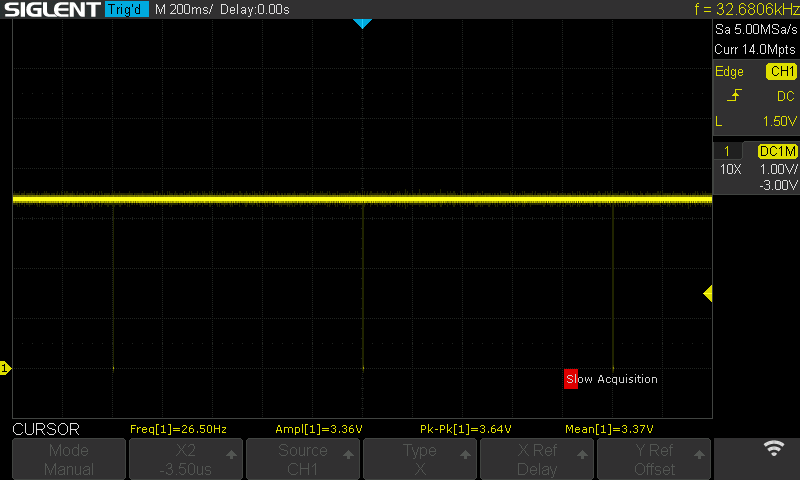

One whole burst, about 500 us long:

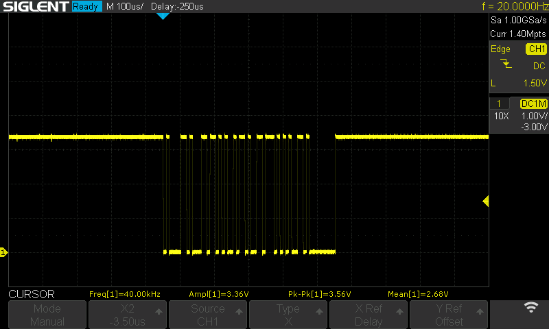

The first byte, bit by bit: start bit, then `a` (0x61) least significant bit
first, 1 0 0 0 0 1 1 0, then the stop bit. Each bit is 8.5 us, about 117,660
baud. The next byte, `l`, starts at the right-hand edge. The whole burst decodes
as `alive` and a zero byte.

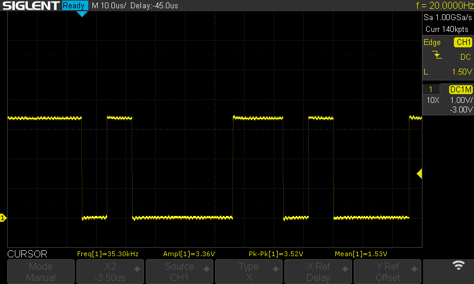

**The other lines, idle.** With no reply to the heartbeat, every other line sits
high and still, between 3.31 and 3.38 V.

| ACC pin (terminal) | Signal | Idle level | Picture |
|---|---|---|---|
| 11 (39) | CNT RX | 3.37 V | [acc-pin11-cnt-rx_idle](docs/images/scope/acc-pin11-cnt-rx_idle_200ms_2026-11-10_1114.png) |
| 6 (13) | CS | 3.31 V | [acc-pin6-cs_idle](docs/images/scope/acc-pin6-cs_idle_200ms_2026-11-10_1110.png) |
| 5 (10) | CLOCK | 3.32 V | [acc-pin5-clk_idle](docs/images/scope/acc-pin5-clk_idle_200ms_2026-11-10_1111.png) |
| 4 (11) | DATA2 | 3.31 V | [acc-pin4-data2_idle](docs/images/scope/acc-pin4-data2_idle_200ms_2026-11-10_1112.png) |
| 3 (14) | DATA1 | 3.34 V | [acc-pin3-data1_idle](docs/images/scope/acc-pin3-data1_idle_200ms_2026-11-10_1109.png) |

### Stage 1, link on: the radio streams

ACC pins 11 and 12 linked (terminals 39 and 38), so the radio's heartbeat comes
back to it.

**ACC pin 6 (terminal 13), CS.** Low 25 times a second: 25.002 Hz, low for
36.54 ms and high for 3.45 ms. Each low is one 4096-byte frame.

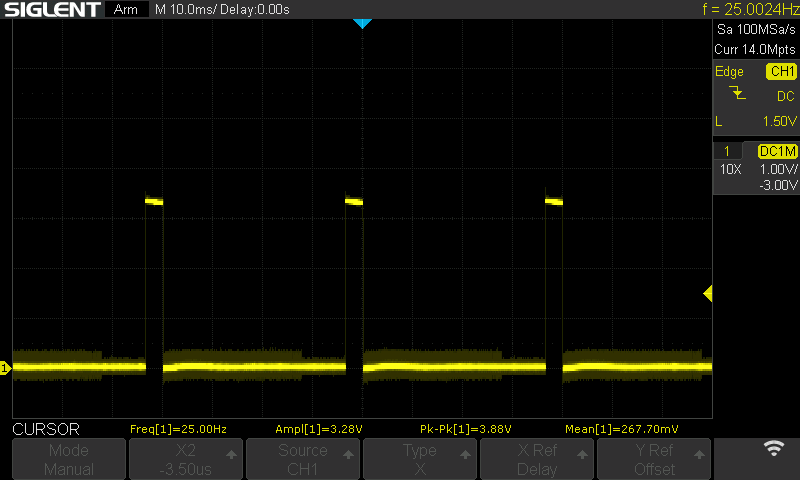

**ACC pin 5 (terminal 10), CLOCK.** 1.97 MHz, in bursts of 8 clocks, one burst a
byte, with a gap between bytes. A byte every 8.9 us, so 4096 bytes take 36.5 ms,
which matches CS. The edges ring, to 3.72 V and -0.40 V; see the note under
DATA1.

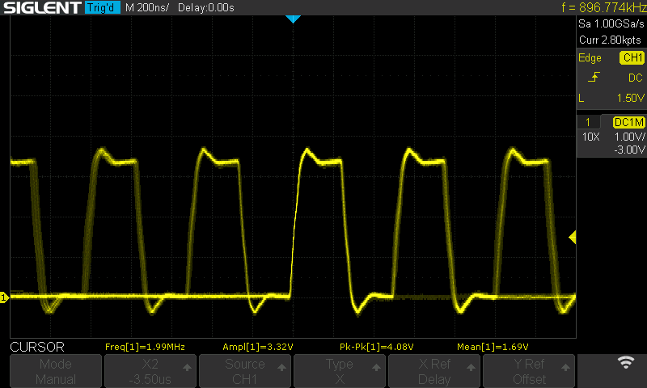

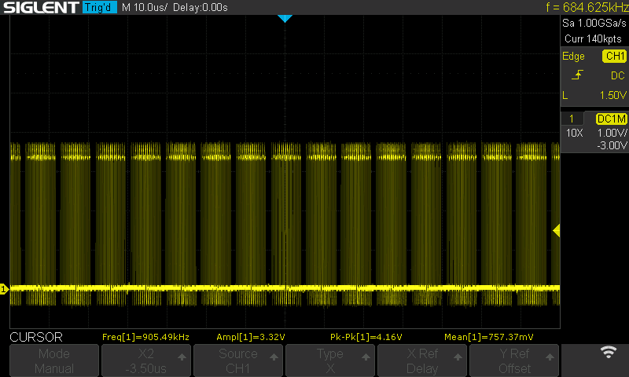

**ACC pin 4 (terminal 11), DATA2.** This is the data. In each 40 ms cycle it
switches for about 27.8 ms, then stays low for about 12.2 ms. CS is high for
3.45 ms of that, so the last 8.7 ms or so of each frame, about 980 bytes, is
zeros.

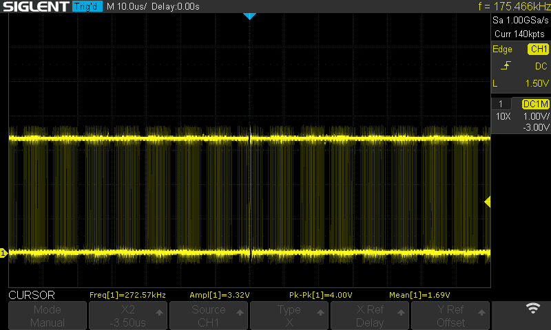

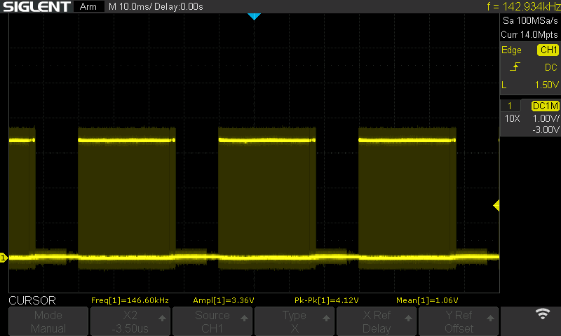

**ACC pin 3 (terminal 14), DATA1.** No data, with the Sub receiver on or off. It
stays high, with about 0.3 V of ripple that follows the frames: crosstalk from
the clock and DATA2 wires beside it. These two were taken with the probe's short
ground spring instead of the long lead, and the ripple still peaks at about
3.9 V, so some of the ringing on the clock and data is coupling between the
cable's wires, not only the probe's ground lead.

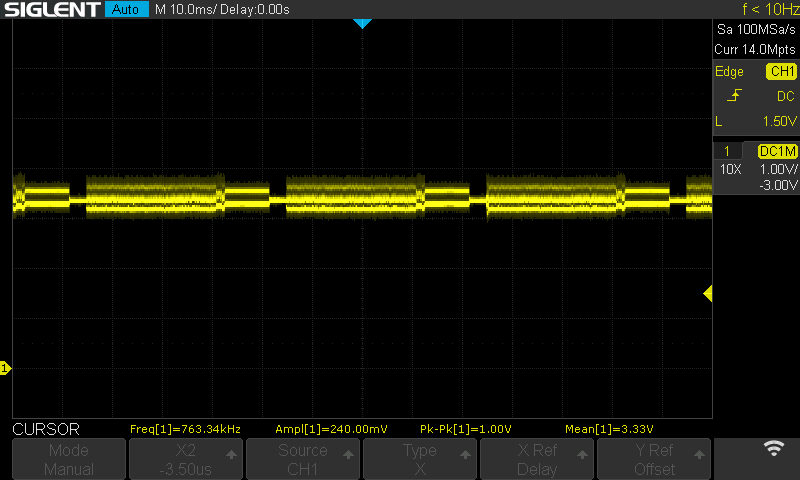


### Stage 1, link off: the data stops

Link taken off. CS stays high for the 14 seconds on screen, and DATA1's ripple has
gone, so the radio sends no frames. The heartbeat reply is what turns the data on.

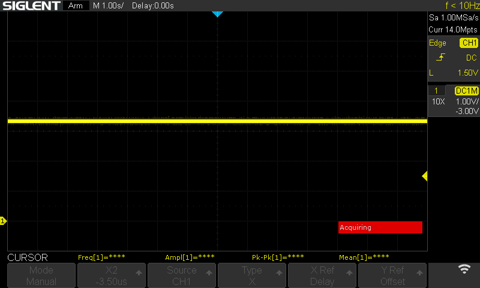

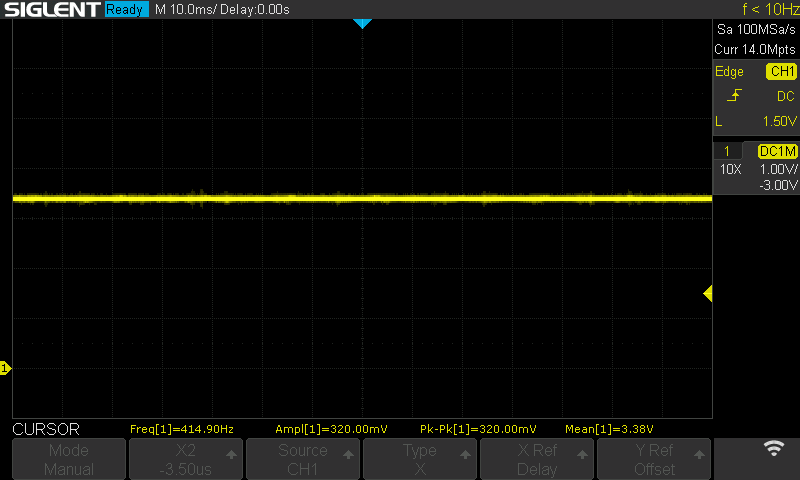

### Still to take

These need two probes at once, or the ESP32 in the board.

| Trace | Probes: ACC pin (terminal) | Timebase | Command, after `python tools/scope_shot.py` |
|---|---|---|---|
| The same burst on 12 and 11, link on | C1: 12 (38), C2: 11 (39) | 100 us/div | `--acc C1=12 C2=11 --note link-burst` |
| The data starting after power-on | C1: 12 (38), C2: 6 (13) | 500 ms/div | `--acc C1=12 C2=6 --note link-start` |
| The start of one frame | C1: 6 (13), C2: 5 (10) | 2 us/div | `--acc C1=6 C2=5 --note link-frame-start` |
| The first bytes of a frame | C1: 6 (13), C2: 5 (10), C3: 4 (11) | 2 us/div | `--acc C1=6 C2=5 C3=4 --note link-first-bytes --samples C1 C2 C3` |
| Stage 2: the first bytes at the ESP32 | C1: 6 (13), C2: 5 (10), C3: 4 (11) | 2 us/div | `--acc C1=6 C2=5 C3=4 --note esp32-first-bytes --samples C1 C2 C3` |
| Stage 2: the clock edges into the ESP32 | C1: 5 (10) | 200 ns/div | `--acc C1=5 --note esp32-clock --samples C1` |

## Comparing with my RSP1 and RSP1B

My FTdx101MP already feeds two SDRplay receivers from its 9 MHz IF outputs: the
RSP1B on VFO A's and the original RSP1 on VFO B's. YWC shows both. Once the ACC
data gives a spectrum, I'll put it side by side with them: the same signals, at the
same moment, with the same centre and span. That shows what the ACC route gives
and what it loses compared with an SDR on the IF, for anyone choosing between
them. It's receive-only, like everything else here.

The method and the results table are in step 7 of [docs/plan.md](docs/plan.md).
The pictures go in [docs/images/compare/](docs/images/compare/).

## Credits and background

This project builds on other people's work on the FTDX10 and FT-710. ratmandu
notes that the FTDX101 uses the same ACC data, but as far as I can find, no one
has yet published captures from an FTDX101MP or D. **None of their code is
used here.** What it takes from them is the physical side: which ACC pins carry the
scope data, the signal levels, the SPI clock and framing, the once-a-second
heartbeat on pins 11 and 12 that wakes the data up, and the finding that the lines
can be wired straight to an ESP32. The code is my own.

- [SLTPLAN/FTDX10_WF_HUB](https://github.com/SLTPLAN/FTDX10_WF_HUB): ESP32-S3
  firmware that shows the FTDX10's scope from the ACC socket. The pin mapping and
  the heartbeat here follow what it found.
- [SLTPLAN/FTDX10_WF](https://github.com/SLTPLAN/FTDX10_WF): the PC side of the
  same project.
- [sanjint.com: Yaesu FTDX10 scope](https://sanjint.com/yaesu-ftdx10-scope): a
  write-up of the ACC signals on the FTDX10.
- [ratmandu/YaesuWFTesting](https://github.com/ratmandu/YaesuWFTesting): the first
  published frame layout, worked out on an FT-710, with test tools.
- [CarrierWaveApp/sculan10-protocol](https://github.com/CarrierWaveApp/sculan10-protocol):
  a written description of the protocol Yaesu's SCU-LAN10 uses on the same lines.

Thanks to all of them. Their pages are the place to read up on how the data was
found.

## Layout

| Folder | What goes there |
|---|---|
| `firmware/` | My own ESP32-S3 firmware |
| `tools/` | Capture and analysis scripts |
| `captures/` | Short frame captures from the radio, with a note of the radio's settings |
| `docs/` | The plan and the bench notes |

If this works, the firmware, wiring and bench notes stay here, and the PC code
goes into YWC as a serial input beside `Ft4222Bridge`.

## Rules

- **Receive-only.** Nothing here keys the radio.
- **Read [docs/fuse-risk.md](docs/fuse-risk.md) before touching the radio.** Pin 8
  is 13.8 V behind a fuse, and pins 9 and 10 are the PTT and SEND lines. ACC pins
  1, 7, 8, 9, 10 and 13 are never connected.
- **Plug and unplug with the supply off.**
- **Check the levels before connecting the ESP32.** Follow
  [Safe first connection](#safe-first-connection).
- **Use the S3's native USB.** The stream is 102.4 kB/s, more than a USB-serial
  chip at 921600 baud can carry.
- **Tools never open COM3 or COM4.** Those are the radio's ports. Name the
  ESP32's port explicitly.
- **No SLTPLAN code in this repo.** Their projects have no licence. Their
  firmware may be flashed as an outside comparison, but it isn't copied here,
  and my firmware is written from scratch, from what's known about the
  signals and from my own captures.

## Licence

GPL-3.0, the same as the other repositories. See [LICENSE](LICENSE). Its sections 15
and 16 also cover the lack of warranty and liability. The repo is private for now.
