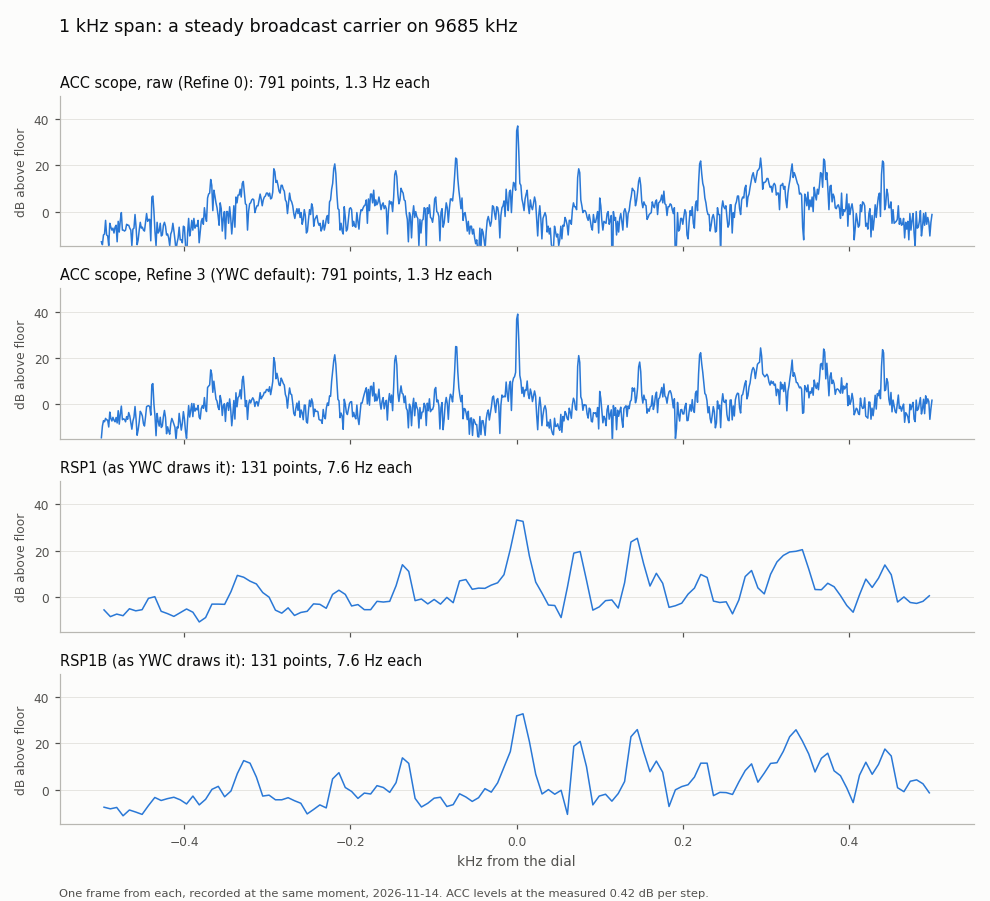
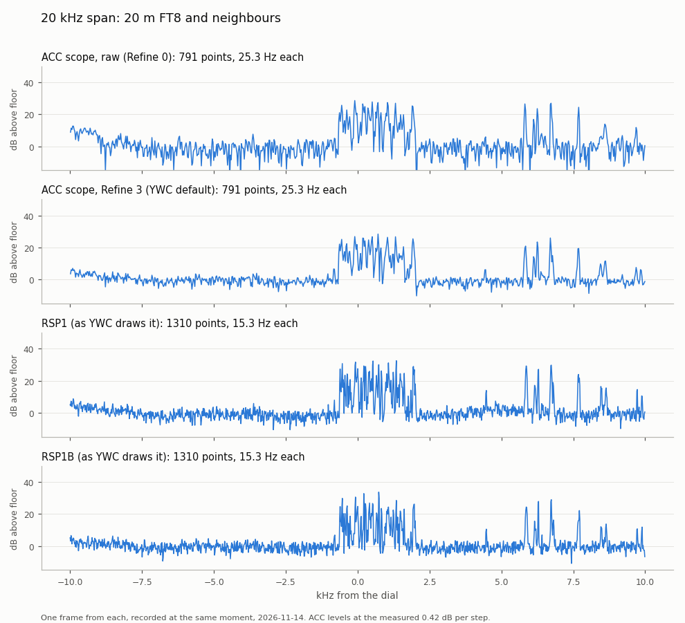
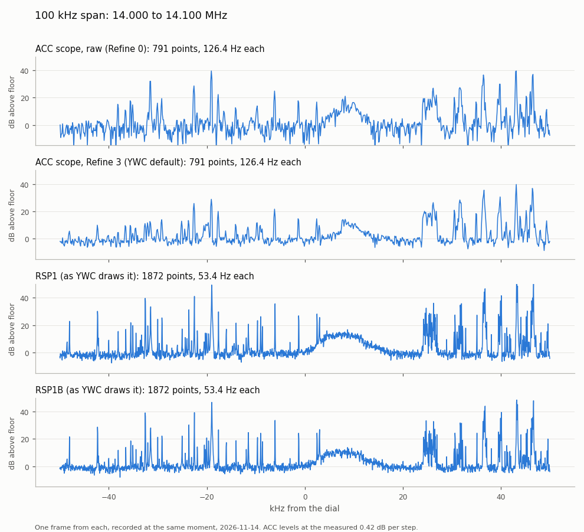

# ACC scope against the RSP1 and RSP1B

Measured on 2026-11-14 on my FTdx101MP, receive only, off-air signals. Three
sources were recorded at the same moment:

- **ACC scope**: the radio's own scope rows from the ACC socket, through the
  ESP32-S3 board and the YaesuAccScope library.
- **RSP1**: an original SDRplay RSP1 on the Sub receiver's IF output
  (8.895 MHz), as Yaesu Web Control (YWC) draws it.
- **RSP1B**: an SDRplay RSP1B on the Main receiver's IF output (9 MHz), as YWC
  draws it.

Main and Sub were set to the same frequency, span and scope settings, so all
three saw the same signals. The aim is facts, not a sales pitch: where the ACC
scope is worse, the table says so.

## Summary

At the 5 kHz, 20 kHz and 1 MHz spans the ACC scope did as well as an SDR on the
IF output, as long as Refine is at 3 (YWC's default) or above. At a 1 kHz span
it is much the sharpest of the three. I didn't measure the 2, 10, 50, 200 and
500 kHz spans, so nothing here claims anything about them. At 100 kHz an SDR is clearly
better, and only an SDR can go wider than 1 MHz. The raw ACC rows (Refine 0)
are well behind everything else. With these IF levels I couldn't see any
difference between the RSP1 and the RSP1B.

## The table

"Clarity" is how far the strongest signal stands above the floor, divided by
how rough the floor is. A bigger number means signals stand out more. It's a
ratio, so it doesn't depend on the dB scale. See [How it was measured](#how-it-was-measured).

| | ACC scope | RSP1 | RSP1B |
|---|---|---|---|
| **What it needs** | The ESP32-S3 board on the ACC socket. One board gives Main and Sub | An IF output from the radio, the SDR, SDRplay's API service | The same |
| **Radios** | FTdx101MP; the FTDX101D and FTDX10 are expected to work | Any radio with an IF output | Any radio with an IF output |
| **Level data** | One byte a point: 256 steps, about 0.42 dB each (measured, ±10%) | 12-bit ADC, levels in dB from an FFT | 14-bit ADC, levels in dB from an FFT |
| **Absolute level** | Not calibrated. Moves with the radio's scope LEVEL | Not calibrated. The RSP's AGC is on (SDRplay's default), so levels float | The same |
| **Spans** | The radio's ten: 1, 2, 5, 10, 20, 50, 100, 200, 500 kHz and 1 MHz | 1 kHz to 2 MHz in YWC, including 15, 30 and 40 kHz | The same |
| **Changing span** | Changes the radio's own scope too | Doesn't touch the radio | The same |
| **Points across the span** | Always 791 | 131 at 1 kHz, 655 at 5 kHz, 1310 at 20 kHz, 1872 at 100 kHz, 1024 at 1 MHz | The same |
| **Hz per point, 1 kHz span** | 1.3 | 7.6 | 7.6 |
| **Hz per point, 5 kHz span** | 6.3 | 7.6 | 7.6 |
| **Hz per point, 20 kHz span** | 25.3 | 15.3 | 15.3 |
| **Hz per point, 100 kHz span** | 126 | 53 | 53 |
| **Hz per point, 1 MHz span** | 1264 | 977 | 977 |
| **Width of a steady carrier, 1 kHz span (6 dB down)** | 2.5 Hz | 15.3 Hz | 15.3 Hz |
| **Carrier position against the dial, 1 kHz span** | +1.0 Hz | +3.5 Hz, after YWC's −44 Hz trim for its 5 ppm crystal | +4.3 Hz, no trim |
| **Frequency reference** | The radio's own, so it always agrees with the dial | Its own plain crystal; needs a trim | Its own TCXO |
| **Frames a second on the PC** | 25 | 10.4 up to 100 kHz, 20.7 at 1 MHz | The same |
| **Lag behind the raw ACC rows** | Refine 0: none; Refine 3: 120 ms; Refine 5: 320 ms | 50 ms | 55 ms |
| **Clarity, 5 kHz span, 20 m FT8** | Refine 0: 9.1; Refine 3: 14.0; Refine 5: 19.2 | 14.8 | 14.1 |
| **Clarity, 20 kHz span, 20 m FT8** | Refine 0: 7.7; Refine 3: 15.9; Refine 5: 23.3 | 16.2 | 15.8 |
| **Clarity, 100 kHz span, 20 m** | Refine 0: 8.5; Refine 3: 16.0; Refine 5: 21.8 | 25.8 | 27.1 |
| **Clarity, 1 MHz span, 13.7-14.7 MHz** | Refine 0: 8.6; Refine 3: 16.2; Refine 5: 20.6 | 17.9 | 17.5 |
| **Floor spread, 20 kHz span** | Refine 0: 4.5 dB; Refine 3: 2.1 dB; Refine 5: 1.4 dB | 2.6 dB | 2.4 dB |
| **Weak FT8 signals, 20 kHz span: how far they stand out** | Refine 0: 3.8×; Refine 3: 7.8×; Refine 5: 11.3× the floor spread | 7.9× | 7.2× |
| **Weak FT8 signals, 20 kHz span: frames where they're visible** | Refine 0: 61%; Refine 3: 74%; Refine 5: 77% | 74% | 73% |
| **Main and Sub** | Identical to each other in every figure | One receiver | One receiver |

The ACC figures are for Main. Sub gave the same to within 0.6 in every row.

## Pictures

Each picture shows one frame from each source, recorded at the same moment.
Levels are dB above each source's own floor, because none of them is
calibrated.

**1 kHz span, a steady carrier.** The ACC scope draws the carrier as a spike a
couple of hertz wide, with the AM sidebands either side as separate lines. The
SDRs, at 7.6 Hz a point, draw a hump 15 Hz wide.

**20 kHz span, 20 m FT8.** Raw ACC rows are visibly rougher. At Refine 3 the
ACC floor is about as smooth as the SDRs', and the FT8 signals look the same.

**100 kHz span.** Here the SDRs win. They have 1872 points to the ACC's 791,
and YWC keeps the strongest of each group of FFT bins, so narrow signals stay
tall and the floor stays tidy.

There are also [5 kHz](images/compare/span-5k-ft8.png) and
[1 MHz](images/compare/span-1m.png) pictures.

## Things to know before you rely on the ACC scope

- **Keep the radio's scope LEVEL up.** The ACC rows are the radio's display
  data, after its LEVEL setting. At LEVEL 0 the floor's dips (at least one
  point in twenty) were already sitting on the bottom step, where weak signals
  disappear. At −15 and −30 most of the floor sat on it. From +10 up the floor was clear of the bottom, and
  +23.5 left plenty of room. The strongest signals I saw never reached the top
  step. LEVEL shifts the rows by about 2.2 steps per dB.
- **The radio's scope PEAK and SPEED settings make no difference** to the ACC
  rows. Switching PEAK between 0 and 3, and SPEED between 0, 2 and 4, left the
  floor and its roughness unchanged.
- **Refine is what makes the ACC scope competitive.** The raw rows are a new,
  rough snapshot every frame. YWC's default Refine 3 smooths with the same
  weight (0.3) that YWC already uses on SDR frames. That's why the two match
  at most spans. Refine 4 and 5 go past the SDRs, at the cost of a trace that
  is a few hundred milliseconds slower to follow a signal.
- **The dB scale is approximate.** About 0.42 dB a step from the attenuator,
  about 0.46 from the LEVEL control (see below). The floor moved by less than
  strong signals did in both tests, so the scale may squash a little near the
  bottom. Figures in dB for the ACC scope carry that uncertainty. The clarity
  figures don't depend on it.

## How it was measured

Tools: [tools/compare/](../tools/compare/). The ACC rows were read straight from
the board. The SDR frames came from YWC's own spectrum feed (develop, as v2.5.5-pre4),
exactly as its pages receive them. That means 16384-point FFTs at 125 kHz up to
a 100 kHz span (7.6 Hz bins), thinned to at most 2048 points by keeping the
strongest of each group, then smoothed by YWC's fixed weight of 0.3.

Settings: ATT off and IPO on both receivers. Scope LEVEL +23.5 on both, PEAK
and SPEED as I normally have them. Same frequency on Main and Sub, Center
placement. One antenna, Saturday afternoon. 40 to 60 seconds per span.

- **Floor.** For each source, the half of the points with the lowest
  long-term average. The floor level is their median in each frame.
- **Floor spread.** Half the distance between the 16th and 84th percentiles of
  the floor points in one frame, averaged over frames. For noise shaped like a
  bell curve, this is the standard deviation. It's what you see as grass on
  the trace.
- **Clarity.** In each frame: (strongest point − floor level) ÷ floor spread,
  then averaged over frames.
- **Weak signals.** Peaks 6 to 20 dB above the floor on an RSP1B average over
  each FT8 period, 56 of them. Each was then measured in every frame of every
  source: (its height − floor level) ÷ floor spread. "Visible" means more than
  3× the spread. Picking the peaks from the RSP1B gives it a slight advantage,
  if anything.
- **Refine steps.** The raw ACC rows were replayed through the same average
  `ScopeRefiner` uses, at YWC's weights: Refine 1 = 0.6, 2 = 0.45, 3 = 0.3,
  4 = 0.2, 5 = 0.12.
- **dB per step.** A steady AM carrier on 9685 kHz, ATT switched between off
  and 6, 12 or 18 dB every 1.5 seconds for 24 seconds. Switching back and forth
  cancels the slow fading. The carrier dropped 13.2 ± 2.4, 27.5 ± 3.6 and 44.0 ±
  2.5 steps: a best fit of 2.38 steps per dB, or 0.42 dB a step. That trusts
  the radio's attenuator to be 6, 12 and 18 dB. The same carrier with LEVEL
  switched between +23.5 and +13.5 moved 21.6 ± 2.7 steps for 10 dB, or about
  0.46 dB a step, which agrees within the error.
- **Frequency.** Where the 9685 kHz carrier peaks at a 1 kHz span, to a
  fraction of a point. At 20 kHz the ACC trace sat one point (25 Hz) lower
  than the SDRs' across the whole span, so the sources agree to within a
  point, not better.
- **Lag.** The total signal in each frame, cross-correlated over the FT8 cycle
  against the raw ACC rows, using the PC's arrival times.

## What this doesn't cover

- **Cheap dongles.** I haven't got one. An 8-bit RTL-SDR has much less dynamic
  range than either RSP, so it would be expected to do worse than these, but
  that isn't measured here.
- **A strong signal right next to a weak one.** No signal generator. The
  figures above are for ordinary band conditions.
- **The SDRs' frame rate.** 10.4 frames a second is what YWC sends at spans up
  to 100 kHz. Its worker allows up to 25, so this is down to how YWC paces its
  frames, not the RSPs. If YWC sends more in future, the SDRs' clarity would
  stay much the same but their trace would move more smoothly.
- **The RSP1 against the RSP1B.** They matched within the noise of the test.
  The radio's IF output sets the noise floor here, not the SDR, so the RSP1B's
  14 bits against the RSP1's 12 don't show. The RSP1's crystal does show: it
  needs YWC's frequency trim.
- **Transmit.** Nothing here transmits.
- **Other radios.** Only my FTdx101MP.
