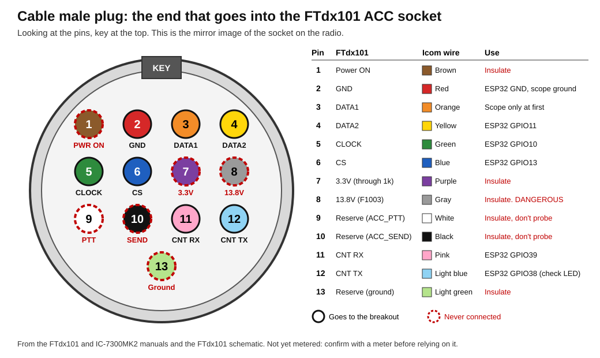

# FTdx101MP: spectrum data from the ACC socket via an ESP32-S3

Status: **draft plan, nothing built.** The cable has arrived and the board is
chosen. See "The cable and the board".

**Use at your own risk.** If you damage your radio, that's your responsibility. See
the [README](../README.md#use-at-your-own-risk).

## What it is

The ACC socket on the back of the FTdx101 is the port the SCU-LAN10 plugs
into. While a listener answers its heartbeat, the radio streams the data for
its own scope over SPI: 4096-byte frames, 25 a second, with the waterfall
for both receivers, the audio FFT and waveform, and a block of settings.

It's the same frame format YWC already decodes for the FT-710
([ft710-native-scope.md](https://github.com/mm5agm/Yaesu_Web_Control/blob/develop/docs/design/ft710-native-scope.md) in YWC), where the radio has the
SPI bridge built in. The FTdx101 has no bridge, so an ESP32-S3 does the job:
it reads SPI from the ACC socket, answers the heartbeat, and sends the
frames to the PC over USB or Wi-Fi.

Receive-only. Nothing in this plan keys the radio.

**Read [fuse-risk.md](fuse-risk.md) before connecting anything.** ACC pin 8 is
13.8 V behind a 3.15 A fuse, and pins 9 and 10 are the PTT and SEND lines.

## ACC socket pinout

From page 17 of the FTdx101 operating manual
(`docs/manuals/FTDX101MP_D_OM_ENG_EH068H213_2102P-JS-3.pdf` in YWC, PDF page 19).

| Pin | Manual label | Function | Direction | This project |
|---|---|---|---|---|
| 1 | Power ON | Remote power-on line (believed to be how the SCU-LAN10 switches the radio on) | into radio | **Not connected** |
| 2 | GND | Signal ground | — | ESP32 GND |
| 3 | DATA1 | SPI data line 1, `ACC_MISO` on the schematic. Function not yet confirmed; the name suggests data into the radio | to be confirmed | Scope first, then ESP32 GPIO14 if useful |
| 4 | DATA2 | SPI data line 2: the scope frames (4096 bytes each) | out of radio | ESP32 GPIO11 |
| 5 | CLOCK | SPI clock, 2 MHz, SPI mode 1. The radio is the SPI master | out of radio | ESP32 GPIO10 |
| 6 | CS | SPI chip select, active low: low for each frame, 25 times a second | out of radio | ESP32 GPIO13 |
| 7 | 3.3V | 3.3 V through a 1k resistor (R1230), about 3 mA at most | out of radio | **Not connected.** It can't power anything |
| 8 | 13.8V | 13.8 V through a 0 ohm link and F1003 (3.15 A) | out of radio | **Not connected.** A short blows the fuse, and a touch on a data pin could damage the radio's logic |
| 9 | Reserve | `ACC_PTT` on the schematic | not known | **Not connected, not probed** |
| 10 | Reserve | `ACC_SEND` on the schematic | not known | **Not connected, not probed** |
| 11 | CNT RX | Control serial into the radio (UART, 115200). Carries the reply to the heartbeat, within 10 ms | into radio | ESP32 GPIO39 (UART TX) |
| 12 | CNT TX | Control serial out of the radio (UART, 115200). Sends the heartbeat `alive\0` once a second | out of radio | ESP32 GPIO38 (UART RX) |
| 13 | Reserve | Ground, through a 0 ohm link (R1106) | — | **Not connected** |

"Direction" is as seen from the radio. The labels in the "Manual label"
column are exactly as printed in the manual; the functions come from the
manual where it says, and otherwise from the Technical Supplement schematic
and the SCU-LAN10 protocol work listed under "Where the code is". The
direction and behaviour of pins 9 and 10 are still unknown.

The socket is a **13-pin mini-DIN**: three rows of four pins plus one at the
bottom by the key. The manual's drawing shows the socket on the radio. That
is the same view as the female end of the extension cable; looking into the
male plug, the layout is mirrored left to right.



This is the cable's male plug, looking at its pins. The IC-7300MK2 plug looks the same,
so the drawing works for both.

## The cable and the board

**The cable isn't cut.** The first idea was to cut the extension cable (13-pin
mini-DIN male to female, Amazon UK B0BRQDDTTZ, £18.99) and use its wires. A
ready-made 13-pin plug with wires attached was available instead, from the
IC-7300MK2, so that plug goes into the cable's female end and its wires are the
ones used. This makes it easier to plug the board into the circuit and unplug it.

```
Radio ACC socket <- cable male | cable female <- IC-7300MK2 plug -> wires -> breakout
```

All 13 pins of the extension cable are confirmed wired.

Icom and Yaesu number the socket the same way. Icom's drawing (IC-7300MK2 Basic
Manual, page 74) is just upside down, with the key at the bottom. The colours below
are from that page and refer to Icom's supplied cable, so they're to be metered
before use and recorded in [bench-notes.md](bench-notes.md).

| Pin | Icom wire colour | FTdx101 label | This project |
|---|---|---|---|
| 1 | Brown | Power ON | **Insulate** |
| 2 | **Red** | GND | ESP32 GND, scope ground |
| 3 | Orange | DATA1 | Scope only at first |
| 4 | Yellow | DATA2 | Scope frames |
| 5 | Green | CLOCK | SPI clock |
| 6 | Blue | CS | SPI chip select |
| 7 | Purple | 3.3V | **Insulate** |
| 8 | **Gray** | 13.8V | **Insulate. The dangerous wire** |
| 9 | White | Reserve (`ACC_PTT`) | **Insulate, not probed** |
| 10 | **Black** | Reserve (`ACC_SEND`) | **Insulate, not probed** |
| 11 | Pink | CNT RX | Heartbeat reply |
| 12 | Light blue | CNT TX | Heartbeat |
| 13 | Light green | Reserve (ground) | **Insulate** |

**Why ground is red.** The colours appear to follow the resistor colour code by pin
number, not by what the wire does: 1 brown, 2 red, 3 orange, 4 yellow, 5 green, 6 blue,
7 purple, 8 gray, 9 white and 10 black (0 in the code). Pink, light blue and light green
then cover pins 11 to 13. Icom's manual doesn't give this reason, but the match is
exact. It means anyone who knows the code can read a wire's pin number from its colour.

So the usual meanings don't apply: red is ground, gray is 13.8 V and black is SEND, not
ground. ESP32 GND and the scope ground go only to the red wire, which is worth marking
as GND with a label or a band of tape. Blue and light blue are different signals, and so
are green and light green.

**The board** is an ESP32-S3 DevKitC-1 N16R8 (WROOM-1-N16R8, marked HW678, Amazon UK
B0F8N8LZ4G). Anything still wired to it from earlier work comes off first.

- It normally has two USB sockets. Use the one marked USB, the S3's native USB, not
  the one marked UART.
- Its RGB LED is on GPIO48, found by scanning the pins one at a time. So GPIO38 is
  free for the heartbeat. Version
  1.1 of the DevKitC-1 has the LED on GPIO38, so another board may differ. It's an
  addressable RGB LED in GRB order, so it takes a data stream, not a plain high or low.
  Drive it with the Adafruit NeoPixel library, kept dim. The core's `neopixelWrite()`
  only ever drives the first pin it was called with, which is no good for a scan.
- The UART socket is the board's CH343 port, COM5 on this PC. Flashing tools are pinned
  to the board's port by name, because COM3 and COM4 are the radio's.

## Pins I need

Seven of the 13: pins 2, 4, 5, 6, 11 and 12, plus pin 3 for probing.

| ACC pin | Manual label | Icom wire | Function | Direction | Why |
|---|---|---|---|---|---|
| 2 | GND | **Red** | Signal ground | — | Common ground with the ESP32 |
| 3 | DATA1 | Orange | SPI data line 1 | to be confirmed | **Scope only at first.** Nothing drives it |
| 4 | DATA2 | Yellow | SPI data line 2 | radio → ESP32 | The scope frames |
| 5 | CLOCK | Green | SPI clock | radio → ESP32 | 2 MHz clock for the data |
| 6 | CS | Blue | SPI chip select | radio → ESP32 | Low for each 4096-byte frame |
| 11 | CNT RX | Pink | Control serial into the radio | ESP32 → radio | Heartbeat reply |
| 12 | CNT TX | Light blue | Control serial out of the radio | radio → ESP32 | Heartbeat, `alive\0` once a second |

## Pins to leave unconnected

The other six.

| ACC pin | Manual label | Icom wire | Function | Why not |
|---|---|---|---|---|
| 1 | Power ON | Brown | Remote power-on line | Switches the radio on; not needed |
| 7 | 3.3V | Purple | 3.3 V through 1k | It can't power anything |
| 8 | 13.8V | **Gray** | 13.8 V through F1003 | A short blows the fuse, and a touch on a data pin could damage the radio's logic |
| 9 | Reserve | White | `ACC_PTT` | The radio's PTT line |
| 10 | Reserve | **Black** | `ACC_SEND` | The radio's SEND line |
| 13 | Reserve | Light green | Ground | Pin 2 is the ground I use |

Insulate each of these wires on its own (heat-shrink, not just tape round the
bundle), with the ends staggered, so none can touch another wire or the ESP32.
None of them reaches the breakout, and they aren't probed.

## Wiring to the ESP32-S3

This is the pin mapping SLTPLAN's firmware uses, so their code runs
unchanged. On a board with its LED on GPIO38, my own firmware can move that signal
to another pin.

| ACC pin | Manual label | Function | ESP32-S3 | Role on the ESP32 |
|---|---|---|---|---|
| 1 | Power ON | Remote power-on line | — | Not connected |
| 2 | GND | Signal ground | GND | Ground |
| 3 | DATA1 | SPI data line 1 | GPIO14 (suggested) | Spare input, only once the scope shows what's on it |
| 4 | DATA2 | SPI data line 2 | GPIO11 | SPI slave data in |
| 5 | CLOCK | SPI clock | GPIO10 | SPI slave clock in |
| 6 | CS | SPI chip select | GPIO13 | SPI slave chip select in |
| 7 | 3.3V | 3.3 V through 1k | — | Not connected |
| 8 | 13.8V | 13.8 V through F1003 | — | Not connected |
| 9 | Reserve | `ACC_PTT` | — | Not connected |
| 10 | Reserve | `ACC_SEND` | — | Not connected |
| 11 | CNT RX | Control serial into the radio | GPIO39 | UART TX (heartbeat reply out) |
| 12 | CNT TX | Control serial out of the radio | GPIO38 | UART RX (heartbeat in) |
| 13 | Reserve | Ground | — | Not connected |

On the screw-terminal expansion board, the wires go here. The terminal marked "3"
is GPIO3, not ACC pin 3. In this photo the bottom row's numbers read the right way up
and the top row's are upside down. The unmarked photo is
[expansion-board.jpg](images/expansion-board.jpg).


Notes:

- Check that GPIO10, 11, 13, 14, 38 and 39 are broken out on the board.
  The N16R8's octal PSRAM takes GPIO35–37, but the pins above don't use those.
  This board's RGB LED is on GPIO48. No ACC signal uses that pin, and my firmware
  will use it for status lights.
- Put a 470 Ω resistor in series with every signal line (pins 3, 4, 5, 6,
  11 and 12), but not ground. On the lines from the radio it limits the
  current if the levels turn out higher than expected or a wire goes to the
  wrong pin, and does no harm at 2 MHz. On pin 11, the one line the ESP32
  drives, it limits the current into the radio's input if the ESP32 is
  powered while the radio is off, or if the wire lands on the wrong pin.
  115200 baud passes through it untouched. Mount the resistors at the ESP32
  end. Why 470 Ω and not another value is in "Resistor value and the 2 MHz
  clock" in the [README](../README.md).
- Keep the wires from the cable to the ESP32 short; it's a 2 MHz clock.
- Power the ESP32 from its own USB lead, never from the ACC socket.

## Before connecting the ESP32: check the levels

The ESP32-S3 takes 3.3 V at most on any pin. With the Icom plug's wires taken
to a breakout but nothing else attached, and the Siglent scope's ground on pin 2.
The supply is off whenever the cable is plugged or unplugged, and pin 8 has been
metered open to every other pin and the shell, as in [fuse-risk.md](fuse-risk.md):

1. **Pin 12:** expect a burst once a second (the `alive\0` heartbeat, UART
   at 115200). Note the high level.
2. **Pins 5 and 6:** with no heartbeat reply the radio may not send
   anything. Link pins 11 and 12 with a jumper (the radio accepts its own
   heartbeat echoed back) and look again. Expect CS going low for each
   frame, 25 times a second, and a 2 MHz clock while it's low. The data
   should start two or three seconds after the link goes on.
3. **Pins 4 and 3:** data while CS is low. Note whether pin 3 is active,
   and whether it changes when the Sub receiver is on.
4. **Take the link off.** The data on pins 4, 5 and 6 should stop within two
   or three seconds, while pin 12 carries on once a second. That shows the
   heartbeat reply is what turns it on.
5. If any level is above 3.3 V, stop and add level shifting before going
   further.

## Where the code is

| Source | Licence | What it gives me |
|---|---|---|
| [SLTPLAN/FTDX10_WF_HUB/ESP32](https://github.com/SLTPLAN/FTDX10_WF_HUB/tree/main/ESP32) | **None** (asked in [issue #1](https://github.com/SLTPLAN/FTDX10_WF_HUB/issues/1)) | Complete ESP32-S3 firmware `DX10_WF.ino` plus `remote.py` |
| [SLTPLAN/FTDX10_WF](https://github.com/SLTPLAN/FTDX10_WF) | None | The PC side of the same project |
| [ratmandu/YaesuWFTesting](https://github.com/ratmandu/YaesuWFTesting) | MIT | First published frame layout and test tools |
| [CarrierWaveApp/sculan10-protocol](https://github.com/CarrierWaveApp/sculan10-protocol) | MIT | Written spec of the SCU-LAN10 protocol |
| [sanjint.com/yaesu-ftdx10-scope](https://sanjint.com/yaesu-ftdx10-scope) | — | Write-up of the ACC signals on the FTdx10 |
| YWC: `Ft710ScopeFrame` and the FT-710 scope path | Mine | The frame decoder and spectrum display I already have |

What SLTPLAN's firmware does:

- Arduino settings: board "ESP32S3 Dev Module", USB Mode "USB-OTG",
  USB CDC On Boot "Disabled".
- Reads each frame as an SPI slave (mode 1, 2 MHz, 4096 bytes while CS is
  low) and answers `alive\0` within 10 ms.
- Sends each frame wrapped as `66 CC FF`, a 2-byte big-endian length, a
  1-byte XOR checksum, then the payload.
- Outputs on USB CDC, on UDP port 51235 (all 25 frames a second, after the
  client sends `HELLO`) and on TCP port 51234.

## Most of it already exists in YWC

The FT-710 sends the same frames over the same kind of SPI link. The
difference is only where the SPI-to-USB bridge sits:

```
FT-710:    radio SPI ──> FT4222H (inside the radio) ──USB──> YWC
FTdx101:   ACC SPI   ──> ESP32-S3 (outside)         ──USB──> YWC
```

Everything after the bridge is already written and working for the FT-710:
`Ft710ScopeFrame` (finding whole frames in the byte stream, decoding them),
CAT placement by `ScopeCatGate`, and the spectrum display. The ESP32 only
has to stand in for the FT4222H.

The FT4222H is a fixed-function chip with no firmware. The ESP32 needs a
little, but only enough to be a dumb pipe:

- **SPI slave:** read the bytes while CS is low (ESP-IDF's `spi_slave`
  driver with DMA does this).
- **USB:** write the bytes out unchanged over USB CDC. No header, no
  checksum. `Ft710ScopeFrame.Assembler` already finds frame boundaries in
  an unaligned stream by their trailer.
- **Heartbeat:** the FT-710 answers its own heartbeat inside the radio; on
  the FTdx101 something outside has to. Either the ESP32 echoes `alive\0`
  back, or pins 11 and 12 are simply linked by a wire and the ESP32 needn't
  touch them at all. The reply has to arrive within 10 ms. The FTDX10
  projects report that SPI starts after two or three answered heartbeats and
  stops two or three seconds after the replies stop.

That's a few dozen lines, so I don't need SLTPLAN's firmware or its
licence. Their code stays useful for a bench comparison in step 3.

What's left to check:

- Whether FTdx101 frames end with the same `FF 01 EE 01` trailer as the
  FT-710's. If they don't, the assembler needs another way to find frame
  boundaries (CS going high is the obvious one, and the ESP32 can mark it).
- The extra content on the FTdx101: the Sub receiver's waterfall at bytes
  850–1699, and whatever differs in the settings block.
- On the YWC side, the source is a USB serial port instead of the FT4222H.
  That's a new input class in `Yaesu_Sdr_Worker` beside `Ft4222Bridge`, not
  a new decoder.

Rules for my own firmware:

- Write it from scratch. Use the facts the other projects found (pins,
  levels, timings, frame layout, the heartbeat) and my own scope captures,
  but no one else's code, not even the MIT projects'. Facts about the
  protocol aren't anyone's property; their code is.
- Credit SLTPLAN for showing that an ESP32-S3 can do it.

## Steps

1. **Cable.** Don't cut it. Check the male plug fits the ACC socket with the
   supply off. Plug the IC-7300MK2 plug into the female end, and meter each
   wire back to the matching pin on the male plug. That confirms Icom's colours
   and the cable's pin-for-pin wiring together. Then insulate pins 1, 7, 8, 9,
   10 and 13, and meter pin 8 open to everything before the plug goes near the
   radio.
2. **Levels.** Scope checks as above, nothing connected to the ESP32.
3. **Bench run.** Flash SLTPLAN's firmware unchanged onto the ESP32-S3,
   wire it as in the table, and read frames with `remote.py` over USB.
   Confirm 25 frames a second and a waterfall that follows the radio.
4. **Decode the FTdx101 frame.** Bytes 0–849 are the Main waterfall
   (bit-inverted, they're in wfview's format), 850–1699 the Sub
   waterfall. Map the settings block (about 144 bytes at the end) by
   changing one control at a time on the radio and diffing captures.
   Work out what pin 3 carries.
5. **My own firmware.** The dumb pipe described above: SPI in, raw bytes
   out over USB CDC.
6. **YWC input.** A serial-port source in `Yaesu_Sdr_Worker` beside
   `Ft4222Bridge`, feeding the existing `Ft710ScopeFrame` path. Centre
   frequency and span come from CAT, as they do for the FT-710. Then the
   FTdx101 additions: Main and Sub waterfalls, each placed on its own VFO.

## Open questions

- Logic levels on the ACC pins: to be measured.
- Does pin 3 carry the Sub receiver, or something else? The schematic calls
  it `ACC_MISO`, which points away from the Sub receiver.
- What do `ACC_PTT` and `ACC_SEND` on pins 9 and 10 do? I don't need them, and
  they aren't to be probed.
- Does the radio need a menu setting before it streams to the ACC socket,
  as the FT-710 does (EX 03-01-26 SCU-LAN10)?
- Firmware: one reseller says the SCU-LAN10 needs FTdx101 firmware of at least
  MAIN V01-14, DISPLAY V01-06, IF DSP V01-05 and SDR V02-03. The ACC stream is
  what the SCU-LAN10 uses, so if the radio doesn't stream with the link on,
  check the firmware versions first.
- Will the radio stream to the ESP32 and an SCU-LAN10 at the same time? Not
  needed now.
