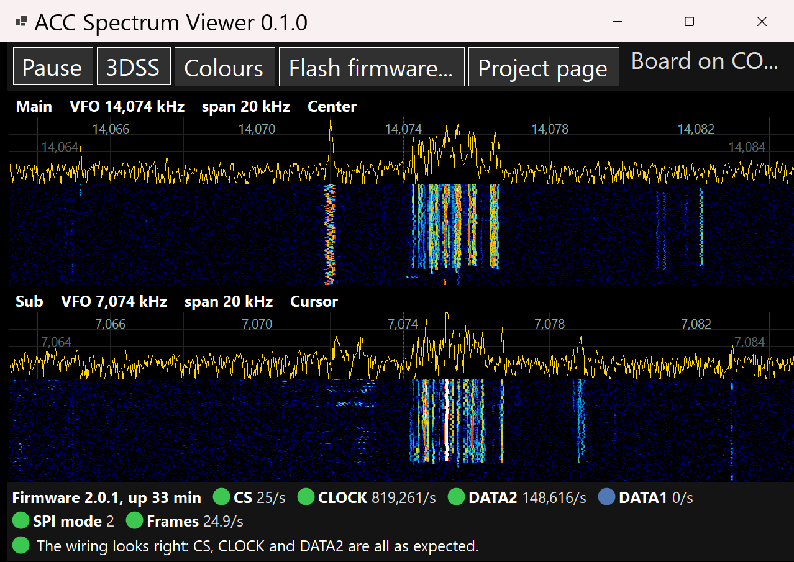
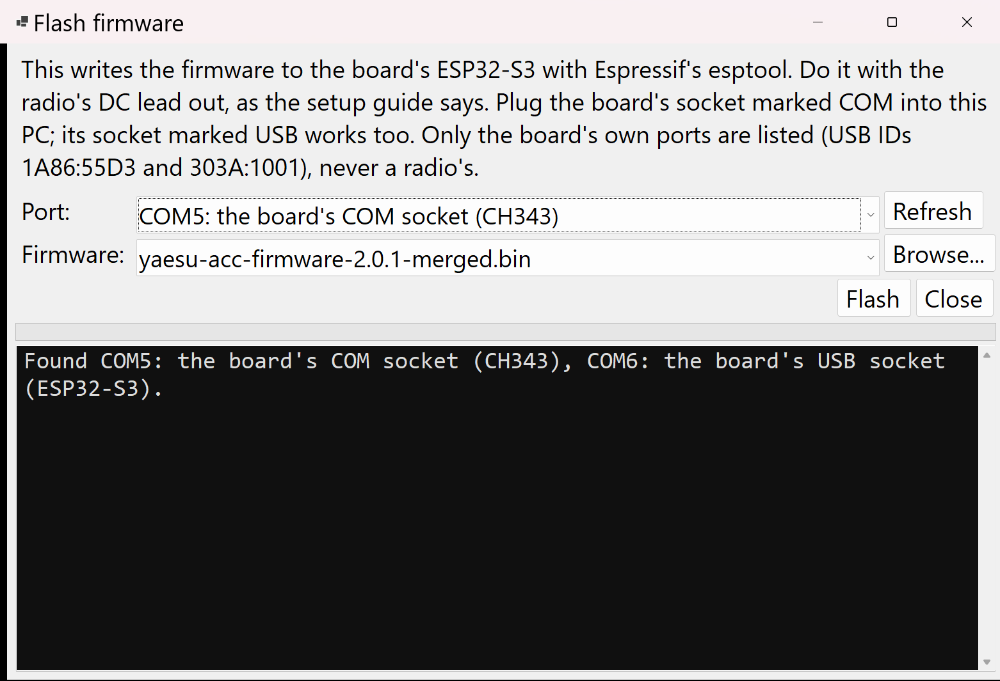
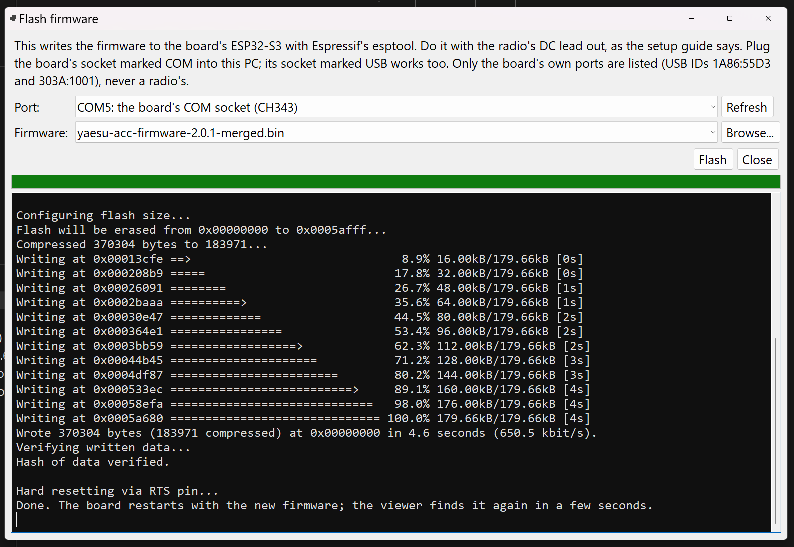
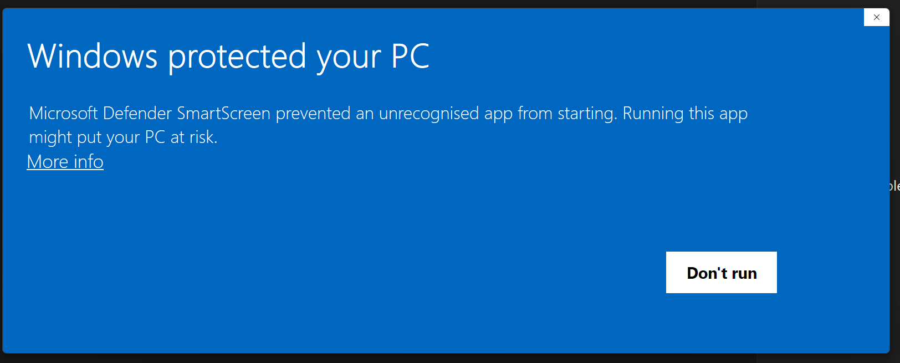
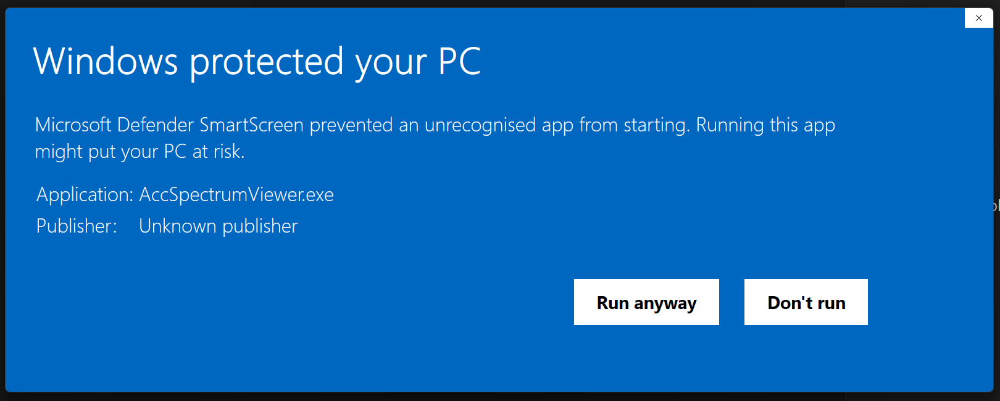

# ACC Spectrum Viewer

A Windows program for the ACC board. It shows the FTdx101's Main and Sub scope
from the ACC socket, checks the wiring, and writes the firmware to the
ESP32-S3. You don't need PlatformIO or Python to use it.

It's also the first real user of the [YaesuAccScope library](../library/README.md):
everything it knows about the board and the frames comes from there.



## What it does

- **Finds the board.** Plug the board's socket marked **USB** into the PC. The
  viewer looks only at Espressif ports (USB ID 303A) and listens quietly,
  without raising DTR or RTS, until it hears the board. If the lead is pulled
  out or the board restarts, it looks again. The title bar says which port it's on.
- **Shows the scope.** For each receiver it draws a trace above a waterfall,
  with the frequency scale worked out from the VFO and span in the radio's own
  frames, and a dashed red line on the VFO.
  - Press **D** or **3DSS** for the last 40 traces in perspective, like the radio's 3DSS.
  - Press **Space** or **Pause** to freeze it.
  - Press **A** or **Colours** to work the waterfall colours out again after a band change.
- **Checks the wiring.** The board sends a status line every 5 seconds, with how
  many times a second each input changes. The bar along the bottom compares
  them with what a working board shows, and says what to check when one is
  missing. Hover over a reading to see which ACC pin and board terminal it's on.

  | Reading | Expected with the radio streaming | ACC pin | Terminal |
  |---|---|---|---|
  | CS | 25/s, one per frame | 6 | 13 |
  | CLOCK | about 819,200/s | 5 | 10 |
  | DATA2 | changes all the time | 4 | 11 |
  | DATA1 | 0: not used | 3 | 14 |
  | Frames | 25/s reaching the PC | | |

  If CS and CLOCK are both 0, the radio isn't sending. Check it's switched on,
  that ACC pins 11 and 12 are linked so it streams, and that ground (ACC pin 2)
  is connected. The wiring check needs firmware 2.0 or later.
- **Flashes the firmware.** **Flash firmware...** writes the firmware that comes
  with the viewer, or a `-merged.bin` you choose, using Espressif's esptool.



## Flashing safely

- **Take the radio's DC lead out first,** as for any bench work on the board.
- Plug the board's socket marked **COM** into the PC; its socket marked **USB**
  works too.
- The port list only ever shows the board's own two ports, found by USB ID:
  the CH343 on the COM socket (1A86:55D3) and the ESP32-S3's own port on the USB
  socket (303A:1001). A radio's CAT port is never listed. esptool raises DTR
  and RTS to reset the chip, and on a radio's CAT port those lines can key the
  transmitter.
- The viewer lets go of the board while it flashes, then finds it again.
- If esptool can't connect, put the board into download mode by hand. Hold
  **BOOT**, press and let go of **RST**, let go of BOOT, then press Flash again.

### What a good flash looks like

It takes about 5 seconds. The progress bar fills, and the log counts up to
100%. Then it says **Hash of data verified**, which means the firmware was read
back and matches. After that come **Hard resetting via RTS pin** and **Done**.
The board restarts with the new firmware. Close the window, and the viewer
finds the board again on its USB socket.



## Running it

Download `AccSpectrumViewer-x.y.z-win-x64.zip` from the
[releases](https://github.com/mm5agm/Yaesu_ACC_Spectrum/releases), unzip it
anywhere, and run `AccSpectrumViewer.exe`. Nothing needs installing. .NET is
inside the exe, and esptool and the firmware are in the folders beside it.

### The Windows warning the first time

The first time you run it, Windows may stop it with a blue "Windows protected
your PC" box. That's Microsoft Defender SmartScreen. It shows this for programs
that aren't signed with a paid code-signing certificate, and for programs few
people have downloaded yet. The viewer is neither, so the warning is expected.
It doesn't mean anything was found in it.

1. Click **More info**. At first the only button is **Don't run**.

   

2. Check it says **Application: AccSpectrumViewer.exe**, then click **Run anyway**.
   "Unknown publisher" is expected, because the exe isn't signed.

   

Windows remembers your choice, so it only asks once for each version.
Only download the zip from this repository's
[releases page](https://github.com/mm5agm/Yaesu_ACC_Spectrum/releases).

## Building it

You need the .NET 10 SDK and Windows.

```powershell
powershell -ExecutionPolicy Bypass -File viewer\get-esptool.ps1   # once: puts esptool in viewer\esptool
dotnet test viewer\AccSpectrumViewer.slnx
dotnet run --project viewer\src\AccSpectrumViewer
```

The firmware file comes from `firmware\release\*-merged.bin`. Build it with
PlatformIO (see [firmware/](../firmware)), or download it from the
[firmware release](https://github.com/mm5agm/Yaesu_ACC_Spectrum/releases/tag/firmware-v2.0.1)
into that folder. Without it, Flash firmware still works with **Browse...**.

The release zip is made by [.github/workflows/viewer.yml](../.github/workflows/viewer.yml)
with:

```powershell
dotnet publish viewer\src\AccSpectrumViewer -c Release -r win-x64 --self-contained `
  -p:PublishSingleFile=true -p:IncludeNativeLibrariesForSelfExtract=true -p:EnableCompressionInSingleFile=true
```

## Licence

The viewer is GPL-3.0-only, like the rest of this repository. See
[LICENSE](../LICENSE). The library it uses is LGPL-3.0.

esptool isn't part of the viewer. It's Espressif's program, GPL-2.0-or-later,
and it's shipped unchanged in the `esptool` folder beside the viewer, which
runs it as a separate program. Its licence is in `esptool\LICENSE`. Its source
is at <https://github.com/espressif/esptool>; the release used is
[v5.6.0](https://github.com/espressif/esptool/releases/tag/v5.6.0).
